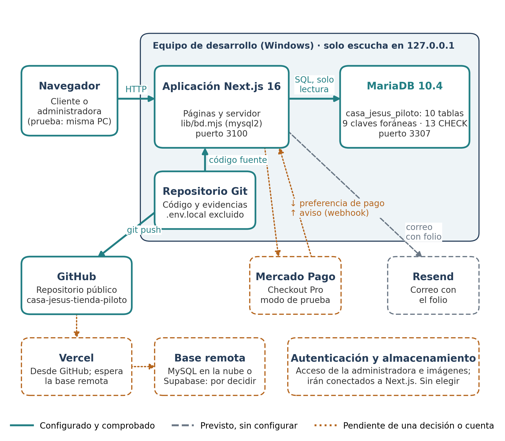
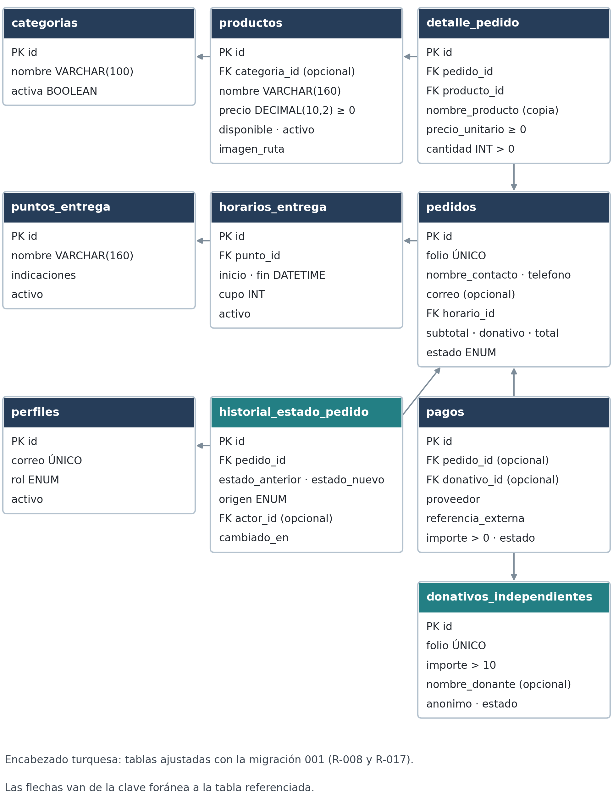
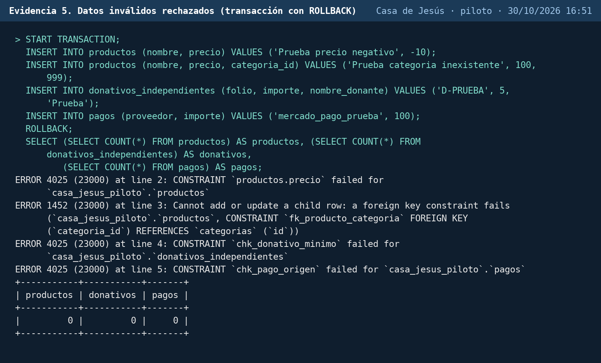
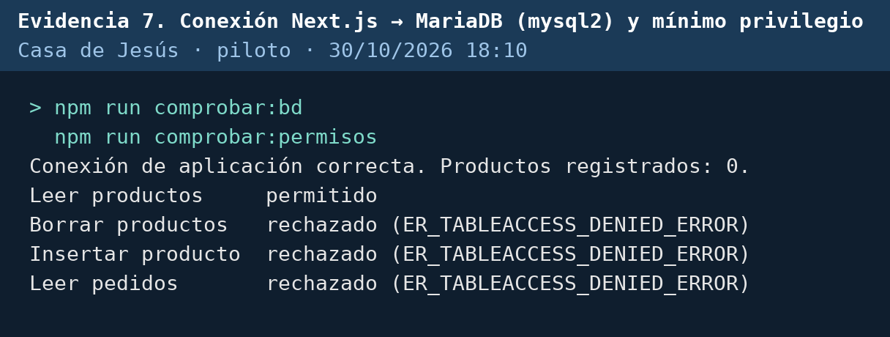
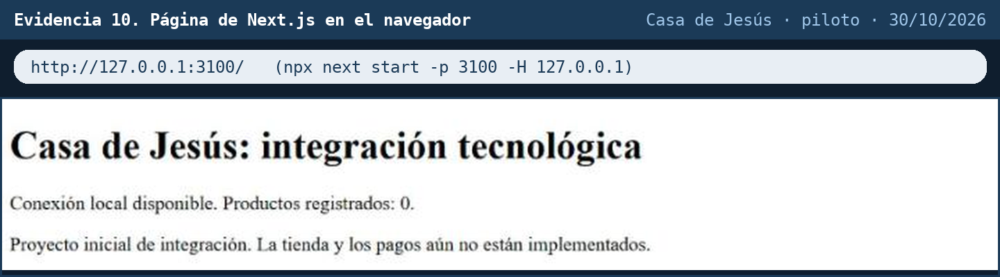
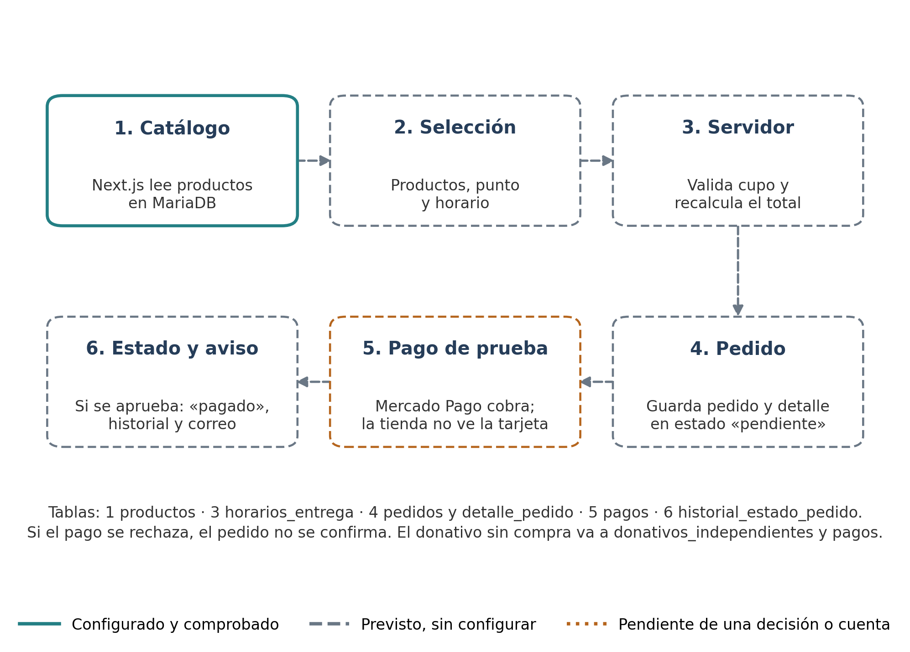

# Integración tecnológica del piloto · Tienda en línea de Casa de Jesús, A.C.

**Taller de Proyecto Social Integrador** · Global University · Licenciatura en Ciberseguridad y Desarrollo de Software<br>
**Equipo 3:** Diego David Lara Martínez y Héctor Oropeza Pelcastre<br>
**Docente:** María de Montserrat Villalobos Solís · **Entrega:** 30 de octubre de 2026

Casa de Jesús es una asociación de Aguascalientes que vende pays y galletas y recibe donativos. En esta etapa se eligieron las tecnologías del piloto, se configuró la base de datos, se conectó la aplicación con ella y se documentó lo que falta. **Todavía no es la tienda**: la interfaz, el flujo de compra, los pagos y las pruebas funcionales son de la siguiente etapa, como marca la guía.

## Resumen del estado

| | Componente | Estado |
|---|---|---|
| ✅ | MariaDB 10.4: base `casa_jesus_piloto` | Configurada y comprobada: 10 tablas, 9 claves foráneas y 13 reglas CHECK |
| ✅ | Next.js 16 → MariaDB (mysql2) | Conectado con una cuenta que solo puede leer productos; probado en el navegador |
| ✅ | GitHub | Este repositorio |
| 🟠 | Base en la nube y Vercel | Pendiente: la base local solo escucha en 127.0.0.1 y Vercel no la alcanza |
| 🟠 | Mercado Pago Checkout Pro (prueba) | Pendiente para la etapa de programación; la tabla `pagos` ya está lista |
| ⚪ | Resend (correo con el folio) | Previsto |
| 🟠 | Autenticación y almacenamiento de imágenes | Por elegir (antes los daba Supabase) |

**Reparto del equipo** (plan del 28 de octubre): Héctor, base de datos (modelo, tablas, relaciones y reglas); Diego, arquitectura, ficha de tecnologías, flujo de datos, repositorio y conexión de la aplicación; los dos, bitácora, revisión y exposición.

## Entregables y criterios de evaluación

| Criterio de la rúbrica | Puntos | Entregable | Dónde está |
|---|---|---|---|
| Arquitectura tecnológica | 20 | 1. Diagrama de arquitectura | [Sección 1](#1-arquitectura-tecnológica) |
| Selección y justificación de tecnologías | 15 | 2. Ficha de tecnologías | [Sección 2](#2-ficha-de-tecnologías) |
| Diseño y configuración inicial de la base de datos | 25 | 3. Diseño inicial de la base de datos | [Sección 3](#3-diseño-inicial-de-la-base-de-datos) |
| Integración inicial de tecnologías | 25 | 4. Evidencia de configuración e integración | [Sección 4](#4-evidencia-de-configuración-e-integración) |
| Documentación técnica y exposición | 15 | 5. Mapa del flujo de datos · 6. Bitácora · 7. Video | [Secciones 5 a 7](#5-mapa-del-flujo-de-datos) |

El documento completo (`Equipo3_Integracion_Tecnologica.pdf`, en Word carta con formato APA) se entregó en Classroom. Este repositorio tiene lo que lo respalda: el código, el esquema y la salida real de cada comprobación.

---

## 1. Arquitectura tecnológica

Las líneas turquesas son conexiones configuradas y comprobadas; las grises, previstas; las naranjas esperan una decisión o una cuenta.



- **Navegador → Next.js → MariaDB:** comprobado (evidencias 7 y 10).
- **Repositorio → GitHub:** comprobado (este repositorio).
- **Mercado Pago:** Next.js manda la preferencia de pago y recibe el aviso (webhook); pendiente.
- **Vercel y base en la nube:** pendientes. No se va a abrir el puerto de la computadora a internet.

## 2. Ficha de tecnologías

| Tecnología | Para qué sirve en el proyecto | Por qué se eligió | Requisitos | Estado |
|---|---|---|---|---|
| MariaDB 10.4 (InnoDB) | Catálogo, pedidos, donativos, pagos y entregas | Ya estaba instalada con XAMPP; MariaDB aplica reglas CHECK e InnoDB maneja claves foráneas y transacciones | R-001 a R-010, R-024 | Configurada y comprobada |
| Next.js 16.4 y React 19.3 | Páginas y código de servidor | Las consultas se hacen en el servidor; las variables sin `NEXT_PUBLIC_` no llegan al navegador | R-003, R-010, R-016 | Compila y lee la base |
| mysql2 | Conexión de Next.js con MariaDB | `execute()` usa consultas preparadas, que separan el SQL de los datos | R-021 | Conectado, solo lectura |
| Git y GitHub | Control de versiones y respaldo del código | Historial de cambios y punto de partida para Vercel | R-027 | Conectado |
| Vercel | Publicar la tienda | Despliega directo desde GitHub | R-027 | Pendiente |
| Mercado Pago Checkout Pro | Cobro en modo de prueba | El cliente paga en la página de Mercado Pago; la tienda nunca ve la tarjeta | R-006, R-007 | Pendiente |
| Resend | Correo con el folio | Envío desde el servidor; el plan gratuito alcanza para la demostración | R-013 | Previsto |
| Autenticación y almacenamiento | Panel de la administradora e imágenes | Falta elegir servicio | R-020, R-021, R-023 | Por elegir |

**Cambio respecto del Parcial 1.** Se proponía Supabase con PostgreSQL. Al empezar no había proyecto de Supabase y XAMPP ya estaba instalado, así que la base se hizo en MariaDB: sigue siendo relacional, se escribe en SQL y no requiere cuentas ni pagos para la demostración. A cambio, la autenticación y el almacenamiento hay que resolverlos aparte. XAMPP trae MariaDB 10.4, que ya no recibe actualizaciones; la base en la nube será una versión con soporte.

## 3. Diseño inicial de la base de datos



- **Esquema:** [`esquema_casa_jesus.sql`](esquema_casa_jesus.sql), con 10 tablas.
- **Migraciones:** [`migraciones/001_historial_y_donativos.sql`](migraciones/001_historial_y_donativos.sql), que agrega al historial el origen del cambio y al donativo folio, nombre opcional y mínimo de $10.

| Decisión | Requisito |
|---|---|
| El pedido no tiene dirección: se recoge en un punto y un horario con cupo | R-004, R-005 |
| `total = subtotal + donativo` lo revisa la base | R-010 |
| El detalle guarda nombre y precio al comprar, para que un cambio de precio no altere pedidos pagados | R-003 |
| El donativo de una compra va en el pedido y el que se hace sin comprar, en su tabla, para no contarlo dos veces | R-008, R-009 |
| Un pago sale de un pedido o de un donativo, nunca de ambos; no hay campos de tarjeta | R-006, R-007 |
| El historial registra si un cambio de estado lo hizo la administradora o el sistema | R-017 |

## 4. Evidencia de configuración e integración

Las evidencias 1 a 9 son la salida real de cada comprobación: [`evidencias/generar_evidencias.py`](evidencias/generar_evidencias.py) ejecuta el comando, guarda la salida sin cambios en un `.txt` y la convierte en imagen. La 10 es una captura del navegador. Ninguna muestra contraseñas.

**Parámetros de configuración (sin credenciales)**

| Componente | Parámetro | Valor |
|---|---|---|
| MariaDB | Servidor y puerto | 127.0.0.1:3307, solo conexiones locales |
| MariaDB | Carpeta de datos | `entorno_local/datos`, separada de otra instancia de XAMPP en el 3306 |
| MariaDB | Cuenta de la aplicación | `cj_piloto_lectura@127.0.0.1`, solo `SELECT` sobre `productos` |
| Next.js | Variables | `DB_HOST`, `DB_PORT`, `DB_NAME`, `DB_USER`, `DB_PASSWORD` en `.env.local` (fuera de Git; plantilla en [`.env.example`](aplicacion/.env.example)) |
| Next.js | Puerto de prueba | 127.0.0.1:3100 |

**Base de datos**

| # | Qué demuestra | Archivo |
|---|---|---|
| 1 | La instancia del piloto: puerto, versión y carpeta de datos | [imagen](evidencias/01_instancia_mariadb.png) · [texto](evidencias/01_instancia_mariadb.txt) |
| 2 | Las 10 tablas InnoDB | [imagen](evidencias/02_tablas.png) · [texto](evidencias/02_tablas.txt) |
| 3 | Las 9 claves foráneas | [imagen](evidencias/03_relaciones.png) · [texto](evidencias/03_relaciones.txt) |
| 4 | Las 13 reglas CHECK | [imagen](evidencias/04_restricciones_check.png) · [texto](evidencias/04_restricciones_check.txt) |
| 5 | Cuatro datos inválidos rechazados en una transacción con `ROLLBACK` | [imagen](evidencias/05_rechazos_integridad.png) · [texto](evidencias/05_rechazos_integridad.txt) |



**Conexión de la aplicación**

| # | Qué demuestra | Archivo |
|---|---|---|
| 6 | La cuenta de la aplicación solo puede leer `productos` | [imagen](evidencias/06_permisos_cuenta_app.png) · [texto](evidencias/06_permisos_cuenta_app.txt) |
| 7 | Next.js lee la base; borrar, insertar y leer pedidos se rechaza | [imagen](evidencias/07_conexion_app.png) · [texto](evidencias/07_conexion_app.txt) |
| 8 | El proyecto compila (`npm run build`) | [imagen](evidencias/08_build_nextjs.png) · [texto](evidencias/08_build_nextjs.txt) |
| 9 | Plantilla de variables y archivos excluidos de Git | [imagen](evidencias/09_configuracion_sin_secretos.png) · [texto](evidencias/09_configuracion_sin_secretos.txt) |
| 10 | La página abierta en el navegador consultando la base | [imagen](evidencias/10_pagina_navegador.png) |





## 5. Mapa del flujo de datos

Hoy solo funciona el paso 1. Los demás describen cómo viajará la información cuando se programe la tienda.



- El servidor recalcula el total con los precios de la base; no confía en lo que mande el navegador.
- El pedido pasa a «pagado» solo cuando el servidor recibe el aviso de Mercado Pago y comprueba su firma.
- Si el pago se rechaza o no se completa, el pedido no se confirma y el lugar del horario se libera.
- Hacia fuera sale lo mínimo: a Mercado Pago, folio, concepto e importe; a Resend, correo y folio.

## 6. Bitácora técnica

[`BITACORA.md`](BITACORA.md) registra qué se configuró, las decisiones, las dificultades y cómo se resolvieron. Lo principal:

- **Instancia separada:** el puerto 3306 lo usa otro proyecto, así que el piloto tiene su propia instancia en el 3307.
- **Migración del esquema:** el modelo se ajustó al revisarlo contra R-008 y R-017.
- **Riesgo encontrado:** la cuenta `root` local no tiene contraseña. Solo acepta conexiones de la misma computadora y se le pondrá antes de guardar datos reales.

**Pendientes para la etapa de programación**

1. Elegir una base en la nube y conectar Vercel al repositorio.
2. Programar el catálogo y los pedidos con control de cupo dentro de una transacción.
3. Configurar Mercado Pago en modo de prueba: preferencia de pago y verificación del aviso.
4. Elegir autenticación y almacenamiento, ponerle contraseña a `root` y configurar Resend.
5. Respaldo semanal de la base con `mysqldump` (R-028).

## 7. Video del equipo

La presentación de Canva (5 a 7 minutos) explica la arquitectura, las tecnologías, la base de datos, las conexiones y los siguientes pasos. El enlace va en el documento entregado en Classroom.

---

## Cómo reproducir las comprobaciones

Requiere los ejecutables de MariaDB de XAMPP y Node.js.

```powershell
entorno_local\iniciar_base.ps1            # inicia solo la instancia del piloto (127.0.0.1:3307)
cd aplicacion
copy .env.example .env.local              # y llenar DB_PASSWORD
npm install
npm run comprobar:bd                      # Next.js lee la base
npm run comprobar:permisos                # la cuenta solo puede leer productos
npm run build                             # el proyecto compila
python ..\evidencias\generar_evidencias.py   # vuelve a generar las evidencias 1 a 9
```

## Archivos

| Carpeta o archivo | Contenido |
|---|---|
| [`esquema_casa_jesus.sql`](esquema_casa_jesus.sql) | Esquema completo de la base |
| [`migraciones/`](migraciones/) | Cambios al esquema después de su creación, en orden |
| [`entorno_local/`](entorno_local/) | Scripts para iniciar y detener solo la instancia del piloto |
| [`aplicacion/`](aplicacion/) | Proyecto Next.js con la conexión y los scripts de comprobación |
| [`evidencias/`](evidencias/) | Salida real de las comprobaciones y el script que las genera |
| [`graficas/`](graficas/) | Diagramas de arquitectura, flujo y modelo, con sus scripts |
| [`BITACORA.md`](BITACORA.md) | Bitácora técnica |

Las credenciales nunca se suben: `.env.local` y la carpeta de datos de la base están en `.gitignore`.
